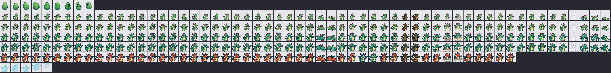

# Sprites à dessiner

> Fichier généré par `tools/gen_sprite_doc.py` à partir de `tools/sprite_manifest.py`.

Les sprites du **dragon** (`assets/sprites/`, aperçu ci-dessous) ont été générés avec Fal par
`tools/fal_dragons.py`. Tout le reste utilise les **sprites provisoires** de `assets/placeholders/`.
Chaque PNG déposé dans `assets/sprites/` (même nom, même dossier) **remplace** le provisoire ou le
dragon à la compilation suivante. Tu peux retoucher ou livrer petit à petit.

## Règles de dessin

| Règle | Valeur |
|---|---|
| Format | PNG |
| Taille créature | **32 x 32** (affichée x3 = 96 x 96 à l'écran 240 x 135) |
| Placement | créature centrée, **pieds sur les lignes 29-31** (le sol) |
| Transparence | canal alpha, ou magenta pur `#FF00FF` |
| Palette | 16 couleurs max conseillé, contour sombre de 1 px |
| Orientation | tournée vers la **droite** (la gauche = miroir automatique) |
| Animation | 1 à 4 images, `_01`, `_02`... (le nombre est libre) |
| Nommage | `assets/sprites/<dossier>/<nom>_NN.png`, ex. `assets/sprites/baby/eat_01.png` |

**Repli automatique** : si une pose manque pour un stade où tu as déjà dessiné quelque chose,
le jeu utilise la pose de repli indiquée (puis `idle`) **de tes dessins**. Si un stade n'a aucun
de tes dessins, ce sont les provisoires qui s'affichent.

Priorités : **P1** indispensable, **P2** recommandé, **P3** bonus.
Conseil : commence par `baby` en complet, puis les autres stades en P1.

## 1. Stades de vie (un dossier par stade)

| Dossier | Stade | Poses à dessiner |
|---|---|---|
| `egg` | Oeuf | 4 poses |
| `baby` | Bébé | 32 poses |
| `child` | Enfant | 32 poses |
| `teen` | Ado | 32 poses |
| `adult_good` | Adulte bien soigné | 32 poses |
| `adult_mid` | Adulte soins moyens | 32 poses |
| `adult_bad` | Adulte négligé | 32 poses |
| `senior` | Vieux | 32 poses |
| `ghost` | Esprit (après la mort) | 2 poses |

## 2. Poses et émotions de la créature

À dessiner pour **chaque** stade vivant : `baby`, `child`, `teen`, `adult_good`, `adult_mid`, `adult_bad`, `senior`.

| # | Fichier | Images | Prio | Repli si absent | Description |
|---|---|---|---|---|---|
| 1 | `idle_01..02.png` | 2 | P1 | — | Respire / se balance légèrement |
| 2 | `walk_01..02.png` | 2 | P1 | idle | Marche vers la droite (la gauche = miroir automatique) |
| 3 | `blink_01.png` | 1 | P2 | idle | Yeux fermés, une image (clignement) |
| 4 | `happy_01..02.png` | 2 | P1 | idle | Sourire, bras levés |
| 5 | `very_happy_01..02.png` | 2 | P2 | happy | Saut de joie (en l'air puis atterrissage) |
| 6 | `love_01..02.png` | 2 | P2 | happy | Yeux en coeur / rougit (caresse) |
| 7 | `sad_01..02.png` | 2 | P1 | idle | Tête basse, yeux tristes |
| 8 | `cry_01..02.png` | 2 | P2 | sad | Pleure (larmes) |
| 9 | `angry_01..02.png` | 2 | P1 | sad | Fâché, joues gonflées, tape du pied |
| 10 | `refuse_01..02.png` | 2 | P1 | angry | Secoue la tête « non » (refuse de manger / jouer) |
| 11 | `surprised_01.png` | 1 | P2 | idle | Yeux ronds, bouche en O |
| 12 | `bored_01..02.png` | 2 | P3 | sad | S'ennuie, regard vide, soupire |
| 13 | `hungry_01..02.png` | 2 | P1 | sad | Se tient le ventre, bave |
| 14 | `eat_01..03.png` | 3 | P1 | happy | Bouche ouverte -> mâche -> mâche |
| 15 | `full_01.png` | 1 | P3 | happy | Ventre rond, satisfait |
| 16 | `sleepy_01..02.png` | 2 | P2 | idle | Bâille, paupières lourdes |
| 17 | `sleep_01..02.png` | 2 | P1 | idle | Dort couché, respiration |
| 18 | `wake_up_01..02.png` | 2 | P3 | idle | S'étire en se réveillant |
| 19 | `sick_01..02.png` | 2 | P1 | sad | Teint verdâtre, frissons |
| 20 | `medicine_01..02.png` | 2 | P2 | refuse | Grimace en avalant le médicament |
| 21 | `dirty_01..02.png` | 2 | P2 | sad | Gêné par la saleté / l'odeur |
| 22 | `poop_01..02.png` | 2 | P1 | idle | Accroupi, fait caca |
| 23 | `wash_01..02.png` | 2 | P2 | happy | Sous la douche, yeux fermés |
| 24 | `scolded_01..02.png` | 2 | P1 | sad | Se fait gronder, penaud |
| 25 | `call_01..02.png` | 2 | P1 | idle | S'agite pour attirer l'attention |
| 26 | `look_left_01.png` | 1 | P1 | idle | Regarde à gauche (mini-jeu) |
| 27 | `look_right_01.png` | 1 | P1 | miroir de look_left | Regarde à droite (mini-jeu), miroir de look_left si absent |
| 28 | `win_01..02.png` | 2 | P1 | very_happy | Victoire au mini-jeu (danse) |
| 29 | `lose_01..02.png` | 2 | P1 | sad | Défaite (déçu) |
| 30 | `evolve_01.png` | 1 | P2 | idle | Silhouette blanche (flash de transformation) |
| 31 | `dying_01..02.png` | 2 | P1 | sick | S'affaiblit, s'effondre |
| 32 | `dead_01.png` | 1 | P1 | sleep | Allongé, yeux en X |

Par stade : **19 poses P1 (36 images)**, 32 poses en tout (58 images).  
Pour les 7 stades vivants : 252 images en P1, 406 images au complet.

## 3. Oeuf (`egg/`)

| Fichier | Images | Description |
|---|---|---|
| `idle_01..02.png` | 2 | Se dandine doucement |
| `wobble_01..02.png` | 2 | (oeuf) tremble fort, éclosion proche |
| `crack_01..03.png` | 3 | (oeuf) fissures de plus en plus grandes |
| `hatch_01..02.png` | 2 | (oeuf) la coquille éclate |

## 4. Esprit (`ghost/`)

| Fichier | Images | Description |
|---|---|---|
| `idle_01..02.png` | 2 | Flotte avec une auréole |
| `ascend_01..03.png` | 3 | (esprit) monte vers le ciel et disparaît |

## 5. Bulles d'émotion (`emotes/`)

Affichées au-dessus de la tête, agrandies x2.

| Fichier | Taille | Images | Usage |
|---|---|---|---|
| `heart_01..02.png` | 16x16 | 2 | Content / caresse |
| `broken_heart_01.png` | 16x16 | 1 | Triste, joie à zéro |
| `anger_01..02.png` | 16x16 | 2 | Veine de colère |
| `sweat_01.png` | 16x16 | 1 | Gêne, effort, se fait gronder |
| `tear_01..02.png` | 16x16 | 2 | Pleure |
| `exclaim_01.png` | 16x16 | 1 | « ! » besoin d'attention |
| `question_01.png` | 16x16 | 1 | « ? » mini-jeu |
| `zzz_01..03.png` | 16x16 | 3 | Dort |
| `note_01..02.png` | 16x16 | 2 | Joyeux / chante |
| `skull_01..02.png` | 16x16 | 2 | Malade |
| `stink_01..02.png` | 16x16 | 2 | Odeur autour des cacas |
| `food_bubble_01.png` | 16x16 | 1 | Pense à la nourriture (faim) |
| `star_01..02.png` | 16x16 | 2 | Victoire |

## 6. Objets (`items/`)

Agrandis x2.

| Fichier | Taille | Images | Usage |
|---|---|---|---|
| `meal_01..04.png` | 16x16 | 4 | Repas : entier -> 3/4 -> 1/2 -> miettes |
| `snack_01..04.png` | 16x16 | 4 | Friandise : entière -> ... -> miettes |
| `pill_01.png` | 16x16 | 1 | Médicament |
| `poop_01..02.png` | 16x16 | 2 | Caca (frémit) |
| `shower_01..02.png` | 32x32 | 2 | Pommeau de douche + gouttes |
| `ball_01..02.png` | 16x16 | 2 | Balle (écran du mini-jeu) |
| `tombstone_01.png` | 32x32 | 1 | Pierre tombale |
| `bed_01.png` | 32x16 | 1 | Lit sous la créature qui dort (bonus) |

## 7. Icônes du menu (`icons/`)

Barre du haut, taille réelle. Version normale + `_sel` (sélectionnée).

| Fichier | Taille | Images | Usage |
|---|---|---|---|
| `food_01.png` | 16x16 | 1 | Menu manger |
| `food_sel_01.png` | 16x16 | 1 | Menu manger (sélectionné) |
| `play_01.png` | 16x16 | 1 | Menu jouer |
| `play_sel_01.png` | 16x16 | 1 | Menu jouer (sélectionné) |
| `clean_01.png` | 16x16 | 1 | Menu nettoyer |
| `clean_sel_01.png` | 16x16 | 1 | Menu nettoyer (sélectionné) |
| `medicine_01.png` | 16x16 | 1 | Menu soigner |
| `medicine_sel_01.png` | 16x16 | 1 | Menu soigner (sélectionné) |
| `light_01.png` | 16x16 | 1 | Menu lumière |
| `light_sel_01.png` | 16x16 | 1 | Menu lumière (sélectionné) |
| `discipline_01.png` | 16x16 | 1 | Menu gronder |
| `discipline_sel_01.png` | 16x16 | 1 | Menu gronder (sélectionné) |
| `stats_01.png` | 16x16 | 1 | Menu statistiques |
| `stats_sel_01.png` | 16x16 | 1 | Menu statistiques (sélectionné) |
| `settings_01.png` | 16x16 | 1 | Menu réglages |
| `settings_sel_01.png` | 16x16 | 1 | Menu réglages (sélectionné) |
| `attention_01..02.png` | 16x16 | 2 | Alerte « appel » (clignote) |

## 8. Interface (`ui/`)

| Fichier | Taille | Images | Usage |
|---|---|---|---|
| `heart_full_01.png` | 8x8 | 1 | Jauge : coeur plein |
| `heart_empty_01.png` | 8x8 | 1 | Jauge : coeur vide |
| `battery_01..05.png` | 12x8 | 5 | Batterie : 0 à 4 barres (5 images) |
| `sound_on_01.png` | 8x8 | 1 | Son activé |
| `sound_off_01.png` | 8x8 | 1 | Son coupé |
| `arrow_left_01.png` | 8x8 | 1 | Flèche gauche |
| `arrow_right_01.png` | 8x8 | 1 | Flèche droite |
| `cursor_01.png` | 8x8 | 1 | Curseur de menu |
| `scale_01.png` | 16x16 | 1 | Icône poids |
| `cake_01.png` | 16x16 | 1 | Icône âge |

## 9. Effets (`fx/`)

| Fichier | Taille | Images | Usage |
|---|---|---|---|
| `sparkle_01..03.png` | 32x32 | 3 | Étincelles d'évolution |

## 10. Fonds optionnels (`bg/`)

Sans fichier, un fond uni est dessiné. Un fond = 64 Ko de mémoire flash.

| Fichier | Taille | Usage |
|---|---|---|
| `day.png` (pas de numéro) | 240x135 | Fond de jour |
| `night.png` (pas de numéro) | 240x135 | Fond de nuit (lumière éteinte) |
| `sick.png` (pas de numéro) | 240x135 | Fond teinté quand malade |
| `game.png` (pas de numéro) | 240x135 | Fond du mini-jeu |
| `title.png` (pas de numéro) | 240x135 | Écran titre avec logo |

## Récapitulatif

- Créature : 32 poses x 7 stades + oeuf (9 images) + esprit (5 images)
- Autres sprites (bulles, objets, icônes, interface, effets) : 74 images
- Fonds optionnels : 5

Après avoir ajouté des PNG : `pio run -t upload` (la conversion est automatique). Pour régénérer l'aperçu : `python3 tools/make_placeholders.py --sheet docs/sprites_preview.png`.
